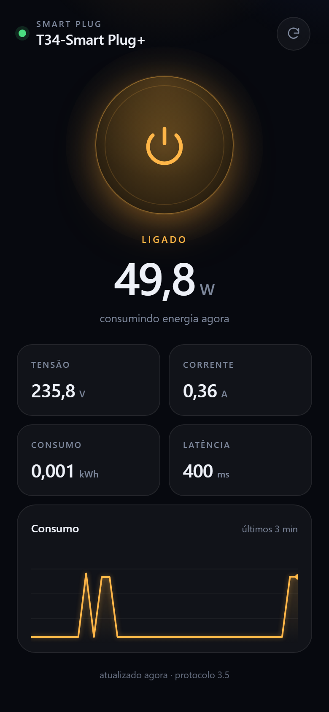

# Smart Plug — controle local do seu plug Tuya

Backend próprio + PWA para controlar um smart plug Tuya (Smart Life / Tuya Smart)
**direto na rede local**, com a nuvem da Tuya como reserva quando o plug não
está acessível na LAN.

```
                   ┌──────────────────┐   TCP 6668 (LAN)   ┌──────────┐
┌──────────────┐   │                  │◄──────────────────►│   plug   │
│ PWA (celular)│◄─►│   este servidor  │                    └──────────┘
└──────────────┘   │                  │   HTTPS (fallback)
  HTTP/WebSocket   └──────────────────┘◄──────────────────► nuvem da Tuya
```

> Documentação para quem for continuar o projeto:
> [`AGENTS.md`](AGENTS.md) (guia operacional) e
> [`docs/ARQUITETURA.md`](docs/ARQUITETURA.md) (referência técnica).



## O que ele faz

- Liga e desliga o plug em ~50 ms na LAN, sem passar pela nuvem.
- Mostra potência, tensão, corrente, consumo acumulado e latência.
- Descobre sozinho o **mapa de DPs** do modelo (cada fabricante usa IDs e escalas próprios) e o **protocolo** (3.1 a 3.5).
- Cai para a **nuvem da Tuya** automaticamente quando a LAN falha (`via=cloud`).
- Atualiza em tempo real por WebSocket, com reconexão automática.
- Funciona como app no celular (PWA), sem loja e sem mensalidade.

## Requisitos

- Node.js 18 ou superior.
- O plug já pareado no app Smart Life (ele precisa estar "ativado").
- Para o modo local: computador e plug na **mesma rede**, com o app do celular
  **fechado** (o plug aceita apenas uma conexão TCP por vez). O modo nuvem não
  precisa disso.

## Passo 1 — instalar e encontrar o plug

```bash
npm install
npm run scan
```

O scan escuta o broadcast UDP da Tuya e mostra `Device ID` e `IP` de cada
aparelho na rede.

## Passo 2 — conta de desenvolvedor Tuya (uma única vez)

A `local_key` do aparelho só existe na nuvem da Tuya. Para obtê-la:

1. Crie uma conta em <https://iot.tuya.com> e um **Cloud Project**
   (o *Data Center* precisa ser o mesmo da sua conta; o `setup` detecta
   sozinho qual é, testando todos os endpoints).
2. Anote **Access ID** e **Access Secret** (aba *Overview* do projeto).
3. Em **Devices → Link App Account → Add App Account**, escolha *Automatic*
   e escaneie o QR code com o app Smart Life (aba **Me** → ícone de QR).
   Sem esse passo a aba *Devices* fica vazia e a Tuya responde
   `1106 permission deny` — é o erro mais comum.
4. Em **Service API**, autorize os serviços **IoT Core** e **Authorization**.

> O plano gratuito do *IoT Core* expira de tempos em tempos. Você só precisa
> renová-lo se quiser rodar o `setup` de novo (por exemplo, depois de reparar
> o plug, que troca a `local_key`).

## Passo 3 — configurar

```bash
npm run setup
```

O assistente pergunta o Device ID, o IP (opcional) e as credenciais do
projeto, descobre o data center (ou aceita `--region us-east`) e grava
tudo em `config.json`.

Para diagnosticar credenciais/região antes de configurar:

```bash
node src/setup.js --probe --id <device-id> --client-id <id> --client-secret <secret>
```

## Passo 4 — rodar

```bash
npm start
```

Abra no celular o endereço mostrado no terminal (`http://SEU-IP:3000`) e
adicione à tela de início:

- **Android/Chrome:** menu ⋮ → *Instalar app* / *Adicionar à tela inicial*.
- **iOS/Safari:** Compartilhar → *Adicionar à Tela de Início*.

Para ver a interface sem o plug: `npm run mock`.

## Controle de qualquer lugar

O app fala com **este servidor**, não com o plug. Para usar fora de casa há
três caminhos — e o servidor já sabe alternar entre LAN e nuvem sozinho
(`mode: "auto"`: LAN primeiro, nuvem quando a LAN falha).

### A. Servidor em casa + Tailscale (recomendado)

Mantém o controle local (rápido, sem nuvem) e dispensa abrir portas no roteador.

```bash
# no PC e no celular, mesma conta Tailscale
tailscale up
tailscale serve https / http://localhost:3000   # opcional: HTTPS para instalar como PWA
```

O app passa a responder no IP `100.x.y.z` da sua tailnet, de qualquer rede.

### B. Servidor hospedado fora de casa (VPS) em modo nuvem

Se você não quer depender da rede/internet de casa, rode o servidor num VPS
e deixe-o falar só com a nuvem da Tuya:

```json
{ "mode": "cloud" }
```

```bash
SMARTPLUG_MODE=cloud npm start     # ou PORT=8080 npm start
```

Latência maior (~0,5–1 s) e dependência da API da Tuya (o trial do IoT Core
precisa estar válido), mas funciona mesmo com a casa offline.

### C. Cloudflare Tunnel

Expõe o servidor de casa com HTTPS e domínio próprio, sem abrir portas:

```bash
cloudflared tunnel --url http://localhost:3000
```

> Em qualquer exposição pública, defina `server.token` no `config.json`
> (o app pede o token na primeira vez) e não deixe a porta aberta sem HTTPS.

## Configuração (`config.json`)

| Campo | Padrão | Descrição |
| --- | --- | --- |
| `mode` | `auto` | `auto` (LAN → nuvem), `local` ou `cloud` |
| `cloud.enabled` | `false` | Liga o controle pela nuvem (o `setup` já preenche) |
| `cloud.clientId` / `cloud.clientSecret` | — | Credenciais do projeto Tuya |
| `cloud.region` | `us` | Data center (`us`, `us-east`, `eu`, …) |
| `codes.*` | — | Códigos dos DPs na nuvem (`switch_1`, `cur_power`, …) |
| `device.id` | — | Device ID do plug |
| `device.key` | — | `local_key` (16 caracteres) |
| `device.ip` | vazio | IP fixo; vazio = descobre na rede |
| `device.version` | `auto` | Protocolo Tuya; `auto` testa 3.3 → 3.4 → 3.5 |
| `device.name` | `Smart Plug` | Nome exibido no app |
| `dps.*` | 1, 19, 20, 18, 17 | IDs dos data points. O `setup` preenche com a especificação do produto |
| `scaling.*` | `null` | Fator de unidade. O `setup` preenche a partir do `scale` da especificação |
| `polling.intervalMs` | `5000` | Intervalo de leitura |
| `server.port` | `3000` | Porta HTTP (ou use `PORT`) |
| `server.token` | vazio | Se preenchido, exige `x-token` / `?token=` |

**Calibragem:** abra `http://localhost:3000/api/state` e confira o campo
`raw` — ele traz os DPs crus que o aparelho devolve. Se a potência ou a
tensão vierem com fator 10 errado, ajuste `scaling`.

Os IDs de DP **não são padronizados entre fabricantes**: este mesmo modelo
T34 usa `20`=energia (×10⁻³), `21`=corrente (mA), `22`=potência (×10⁻¹) e
`23`=tensão (×10⁻¹), em vez dos tradicionais `17`/`18`/`19`/`20`. Por isso o
`setup` consulta `/v1.1/devices/{id}/specifications` e grava o mapa certo em
`config.json` (`dps` + `scaling`).

## Problemas comuns

| Sintoma | Causa provável |
| --- | --- |
| `1106 permission deny` no setup | Aparelho não vinculado ao projeto: Devices → Link App Account |
| Sempre em `via=cloud`, LAN nunca conecta | PC e plug em redes/bandas diferentes (2.4 vs 5 GHz com isolamento) ou IP do plug mudou. Deixe `device.ip` vazio para descobrir sozinho e reserve um IP fixo no roteador |
| `Data centers inconsistency` ao vincular a conta | O projeto está em um data center diferente do da conta do app. Crie um projeto novo no data center correto (não dá para mover um projeto existente) |
| `28841107 data center suspended` | Projeto em outro data center: use `--region us-east` (ou deixe `auto`) |
| `timeout ao conectar` | App Smart Life aberto (uma conexão por vez) ou IP mudou |
| `Configured key is invalid` / erro de decriptação | `local_key` mudou: rode `npm run setup` de novo |
| Aparelho não aparece no `scan` | Outra rede/VLAN, *AP isolation* no roteador ou plug sem energia |
| Potência zerada | Muitos plugs só enviam medição sob demanda; o servidor já força leitura |
| `EADDRINUSE` | Porta em uso: `PORT=8080 npm start` |

## Segurança

- `config.json` guarda a `local_key` do aparelho e, por padrão, as credenciais
  do projeto Tuya (o `setup --no-cloud` evita a segunda). Já está no `.gitignore`.
- O servidor escuta em `0.0.0.0` por padrão; em rede compartilhada ou exposta,
  defina `server.token` e use HTTPS na frente.
- Uso pessoal. Para produto comercial é preciso parceria/OEM com a Tuya.

## Estrutura

```
AGENTS.md            guia operacional (leia primeiro se for continuar o projeto)
docs/
  ARQUITETURA.md     referência técnica: fluxos, API, decisões, armadilhas
  screenshot.png     captura usada no README
src/
  config.js          config.json + defaults + overrides por ambiente
  device.js          LAN + fallback nuvem, estado, reconexão, histórico
  cloud-link.js      cliente da nuvem (token, status, comando)
  tuya-cloud.js      assinatura HMAC, data centers, descoberta, especificações
  normalize.js       DPs crus → W, V, A, kWh
  dps.js             especificação do produto → mapa de DPs
  setup.js           assistente de configuração
  scan.js            descoberta de aparelhos na LAN
  server.js          HTTP + WebSocket + arquivos estáticos
public/              PWA (HTML, CSS, JS, manifest, service worker, ícones)
tools/               gerador de ícones
```

## Licença

MIT.
